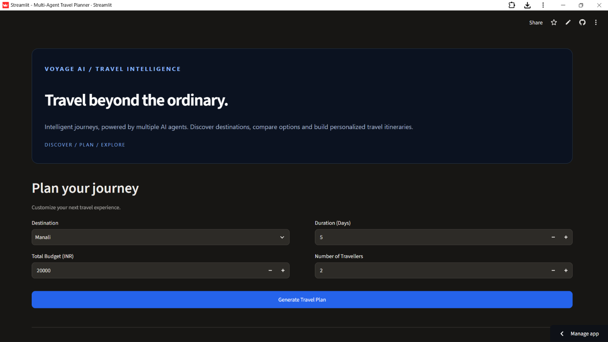
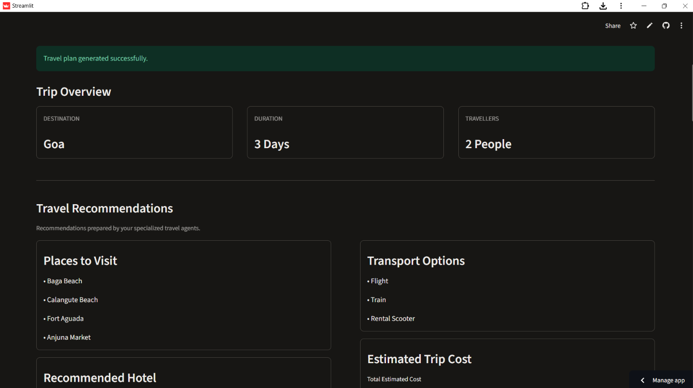
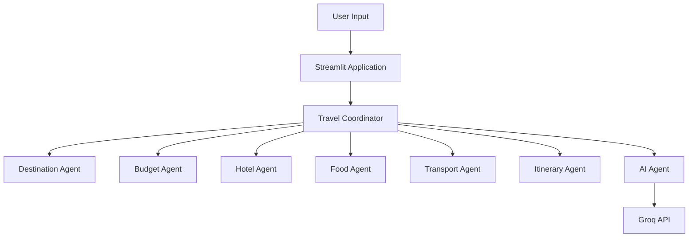

# 🌍 Voyage AI — Multi-Agent Travel Planner

An AI-powered travel planning web application built using Python, Streamlit, and Groq AI.

**Voyage AI** helps users generate personalized travel itineraries based on their destination, budget, trip duration, and number of travellers.

## 🌐 Live Demo

## 📸 Application Screenshots

### Homepage



### Generated Travel Plan




🚀 **Try Voyage AI here:**
[Launch Voyage AI Travel Planner](https://voyage-ai-travel-planner-pmh37idj6yffzggeydj94c.streamlit.app/)

## 🚀 Features

- AI-powered travel itinerary generation
- Multi-agent travel planning architecture
- Destination recommendations
- Budget estimation and planning
- Hotel and accommodation suggestions
- Food recommendations
- Transportation guidance
- Day-wise travel itineraries
- Downloadable PDF travel reports
- Interactive Streamlit web interface

## 🤖 Multi-Agent Architecture




Voyage AI uses a coordinator to organize the work of specialized travel planning agents.

| Agent | Responsibility |
|---|---|
| Destination Agent | Provides destination information |
| Budget Agent | Estimates travel expenses |
| Hotel Agent | Suggests accommodation options |
| Food Agent | Recommends food experiences |
| Transport Agent | Provides transportation guidance |
| Itinerary Agent | Creates a day-wise travel plan |
| AI Agent | Generates AI-assisted recommendations |

The Travel Coordinator combines agent outputs into a unified travel plan.

## 🛠️ Technologies Used

- **Python** — Application logic
- **Streamlit** — Web interface
- **Groq API** — AI-powered itinerary generation
- **ReportLab** — PDF report generation
- **Git & GitHub** — Version control
- **Streamlit Community Cloud** — Web deployment

## 📂 Project Structure

```text
Multi_Agent_Travel_Planner/
├── agents/
│   ├── ai_agent.py
│   ├── budget_agent.py
│   ├── destination_agent.py
│   ├── food_agent.py
│   ├── hotel_agent.py
│   ├── itinerary_agent.py
│   └── transport_agent.py
├── fonts/
│   └── NotoSans.ttf
├── .streamlit/
│   └── secrets.toml
├── app.py
├── coordinator.py
├── requirements.txt
└── README.md
```

**Note:** The `secrets.toml` file contains private configuration and must not be uploaded to GitHub.

## ⚙️ Installation

1. Clone the repository:

```bash
git clone https://github.com/abhi0119-byte/Voyage-AI-Travel-Planner.git
```

2. Open the project folder:

```bash
cd Voyage-AI-Travel-Planner
```

3. Install dependencies:

```bash
pip install -r requirements.txt
```

4. Create `.streamlit/secrets.toml` and add your Groq API key:

```toml
GROQ_API_KEY = "your_groq_api_key"
```

5. Run the application:

```bash
streamlit run app.py
```

## 🧭 How to Use

1. Open the Voyage AI application.
2. Select a supported travel destination.
3. Enter your travel budget.
4. Choose the trip duration and number of travellers.
5. Generate your travel plan.
6. Review the recommendations and itinerary.
7. Download the travel report as a PDF.

## 📍 Supported Destinations

- Goa
- Manali
- Jaipur
- Shimla
- Rishikesh

## ⚠️ Limitations

- Destination coverage is currently limited.
- Estimated costs may differ from actual travel prices.
- Recommendations do not guarantee real-time availability.
- The application does not directly book hotels or transport.
- AI-generated recommendations should be verified before travel.

## 🔮 Future Enhancements

- More domestic and international destinations
- Real-time hotel and transportation APIs
- Interactive maps
- Weather integration
- User accounts and saved itineraries
- Improved budget optimization

## 🎓 Academic Project

Developed as a **BCA 3rd-Year Minor Project**.

**Developer:** Abhishek Lohia  
**Course:** Bachelor of Computer Applications (BCA)  
**University:** Sushant University

## 👨‍💻 GitHub

[Voyage AI — Source Code](https://github.com/abhi0119-byte/Voyage-AI-Travel-Planner)
